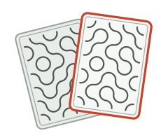

<p align="center">
  <picture>
    <source media="(prefers-color-scheme: dark)" srcset="docs/assets/logo-dark.svg">
    
  </picture>
</p>

<h1 align="center">Bluff</h1>

<p align="center">
  <strong>Planning Poker para times que não querem se influenciar.</strong><br>
  Cada pessoa escolhe uma carta em segredo, e ninguém vê nada até todo mundo virar ao mesmo tempo.
</p>

<p align="center">
  
  
  
  
  
</p>

<p align="center">
  <a href="#funcionalidades">Funcionalidades</a> ·
  <a href="#stack">Stack</a> ·
  <a href="#como-rodar">Como rodar</a> ·
  <a href="#arquitetura">Arquitetura</a> ·
  <a href="#documentação">Documentação</a>
</p>

---

Este repositório é o **front-end** do Bluff. A API fica em
[bluff-backend](https://github.com/NicolasWutkeBartels/bluff-backend).

## Funcionalidades

- **Salas sem cadastro:** crie uma sala, compartilhe o código (ou o link) e o time entra com um apelido.
- **Votos em segredo:** a mesa mostra quem já votou, nunca o valor, até a revelação.
- **Revelação ao mesmo tempo:** as cartas viram juntas, com destaque quando o time chega a um consenso.
- **Tempo real:** entradas, votos e revelações chegam a todos pelo WebSocket, com reconexão automática.
- **Votantes e observadores:** quem conduz a reunião pode acompanhar sem votar.
- **Baralhos:** Fibonacci e camiseta (PP a GG), com estimativa final opcional.
- **Histórico:** rodadas anteriores com os votos revelados, filtráveis por status.
- **Acessível:** navegação por teclado, leitores de tela, tema claro e escuro e respeito a `prefers-reduced-motion`.

## Stack

| Área | Ferramentas |
|---|---|
| Framework | Next.js 16 (App Router), React 19, TypeScript |
| Interface | Tailwind CSS 4, shadcn/ui (Radix), Motion, Lucide |
| Dados | TanStack Query, Axios, Zod |
| Formulários | React Hook Form + Zod, componentes `Field` do shadcn |
| Tempo real | STOMP sobre WebSocket (`@stomp/stompjs`) |

## Como rodar

**Pré-requisitos:** Node.js 22+ e a [API do Bluff](https://github.com/NicolasWutkeBartels/bluff-backend) rodando.

```bash
cp .env.example .env.local
npm install
npm run dev
```

O app abre em [http://localhost:3000](http://localhost:3000).

### Variáveis de ambiente

| Variável | Padrão | Descrição |
|---|---|---|
| `NEXT_PUBLIC_API_URL` | `http://localhost:8080` | Endereço da API. O WebSocket usa o mesmo host com `ws://` e o caminho `/ws`. |

Em produção, a origem do front precisa estar em `CORS_ORIGENS` na API.

### Scripts

| Comando | O que faz |
|---|---|
| `npm run dev` | Servidor de desenvolvimento |
| `npm run build` | Build de produção |
| `npm run start` | Sobe o build de produção |
| `npm run lint` | ESLint |

## Arquitetura

O caminho de um dado é sempre **componente → hook → service → API**. Toda resposta da API
passa por um esquema Zod antes de chegar à tela, e os eventos do WebSocket atualizam o mesmo
cache do React Query que as requisições REST.

```
src/
├── app/            rotas: / (home) e /sala/[codigo]; a page só orquestra
├── components/
│   ├── ui/         componentes do shadcn com a identidade do Bluff
│   ├── form/       Form e campos (TextField, SelectField...) sobre React Hook Form
│   ├── carta/      a carta, o verso Truchet e a animação de revelação
│   ├── marca/      logo
│   ├── home/       seções e formulários da home
│   └── sala/       mesa, mão, painel da rodada, histórico e conexão
├── hooks/          queries, mutations, WebSocket ao vivo e voto otimista
├── services/       requisições REST, um arquivo por recurso
├── schemas/        esquemas Zod de formulários, respostas e eventos
├── types/          tipos genéricos reutilizáveis
├── constants/      valores fixos (status, animações, marca)
└── lib/            utilitários puros (localStorage, Truchet, estado da sala)
```

## Documentação

- [Convenções do código](docs/convencoes.md): camadas, nomes, props, tipos, formulários e Tailwind.
- [Design](docs/design.md): conceito visual, cores, tipografia, layout e movimento.
- [Aprendizado](https://github.com/NicolasWutkeBartels/bluff-backend/blob/main/docs/aprendizado.md)
  (no repositório da API): o caminho de um voto do clique até o banco.
